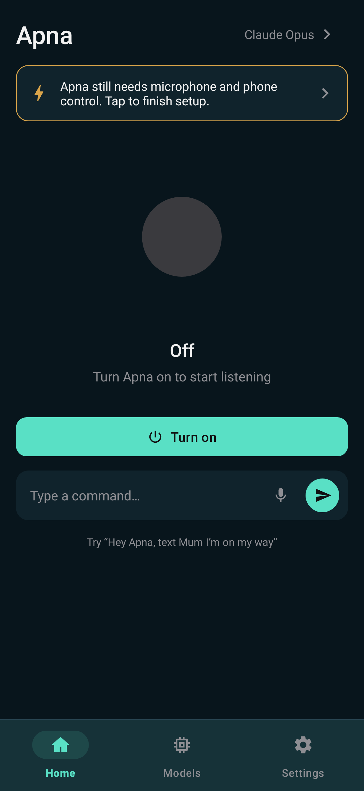
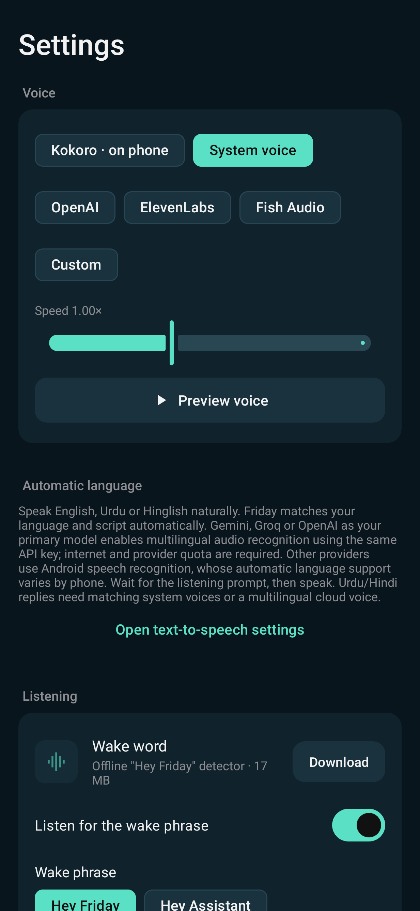

# Friday

Your own hands-free Android voice and phone assistant for Project 33.

**Automatic language:** speak or type English, Urdu, Roman Urdu, Hindi or Hinglish. Friday infers language/script from each request and the conversation; there are no language buttons. Old language selections are ignored.

**Development build:** actual wake accuracy, battery use and live-provider task success must be measured on your phone. This is a customized, MIT-licensed derivative of [Jarvis](https://github.com/judejulius/jarvis), with original attribution preserved. See [source analysis](docs/REVERSE_ENGINEERING.md), [credits](THIRD_PARTY.md) and [validation](docs/VALIDATION.md).

 

## Features

- On-device wake phrases: **Hey Friday**, **Hey Assistant**, **Hey Computer**. Select in Settings, then turn the assistant off and on.
- Spoken multi-turn conversation, short-term context and interruption, through automatic multilingual speech recognition, a tool-calling language model and speech synthesis.
- Local **go to sleep**, **goodbye** and **stand by** commands clear conversation and return to wake-only listening. Configurable 5–60 second silence timeout after replies.
- Open apps, read visible screen content, tap, type, scroll, swipe, Back/Home, notifications and optional screenshots through Android Accessibility.
- Direct battery, media volume, search, URL, alarm, timer, dialer and SMS-draft actions. Other app workflows use the screen agent.
- Bundled Markdown phone/conversation skills, provider connection tests, fallback models, task overlay and persistent notification with stop controls.

Examples: “Hey Friday, open YouTube”, “set a timer for five minutes”, “what is my battery level?”, “set media volume to 30 percent”, “search for the weather in Lahore”, “open WhatsApp and send Ali I am on my way”, then “go to sleep”. Ambiguous contacts require clarification.

## Install and configure

1. Use an **ARM64 Android 8.0+** phone. This build does not contain 32-bit ARM binaries. Ordinary conversation works while locked; unlock before app-control tasks.
2. Extract `app-debug.apk` from a successful GitHub Actions artifact. If Play Protect shows **“App blocked to protect your device”** with a sensitive-data/fraud warning, follow the [Windows development-install guide](docs/INSTALL_WINDOWS.md). Accessibility apps downloaded through a browser can trigger this block; changing Android versions or re-signing alone does not resolve it.
3. Open Friday; grant microphone permission and enable **Friday phone control** in Accessibility. Configure background power settings for your device.
4. Download wake detection (~17 MB). System TTS is the initial voice; install Urdu/Hindi voice data for those spoken replies. Kokoro (~100 MB) is optional for English only. The old English-only command model is not required by automatic mode.
5. Add a tool-calling provider in **Models** and use **Test connection**. Supply your own provider API key, or use an OpenAI-compatible local server such as Ollama/LM Studio. Model IDs are editable; availability varies. A ChatGPT subscription does not supply API credit.
6. Turn the assistant on once. Wake it by voice; subsequent turns need no button press.

On Android 13+, sideloading may require App info → menu → **Allow restricted settings** for Accessibility. Android 14+ can prevent microphone startup at boot; open the app and turn it on. OEM battery settings can stop background operation. The app cannot bypass lock screens, app security, CAPTCHAs or Android's restrictions.

## Build

JDK 17+, Android SDK platform 35, and the included Gradle wrapper:

```sh
./gradlew assembleDebug testDebugUnitTest lintDebug
adb install -r app/build/outputs/apk/debug/app-debug.apk
```

If needed, create gitignored `local.properties` containing `sdk.dir=/your/android/sdk`. The first build downloads a pinned sherpa-onnx library and verifies its SHA-256. Models are downloaded in the app, not committed.

## Architecture

```text
STANDBY: microphone → local keyword spotter
                          ↓ wake
ACTIVE: automatic STT → LLM + tool loop → speech output
                      ↕
         accessibility screen / Android actions
                          ↓ sleep or silence timeout
STANDBY: clear task and conversation; resume local wake detection
```

`ApnaService` controls the lifecycle; `VoiceInput` owns the microphone and speech engines; `PhoneAgent` observes, runs one tool and checks a fresh screen; `DeviceActions` implements native intents and settings. No root or ADB is needed for app control. Extend runtime skills in `app/src/main/assets/skills/` and register their folders in `Settings.skillInstructions()`.

This version uses **STT → LLM → TTS**, not OpenAI Realtime/WebRTC speech-to-speech. Response delay depends on the selected model, network and voice engine.

## Automatic multilingual speech

- With **Gemini, Groq or OpenAI as the primary model**, Friday captures a short command after the wake prompt and sends it to that same provider using its configured API key. Gemini transcribes audio with the configured audio-capable model; Groq uses `whisper-large-v3-turbo`; OpenAI uses `whisper-1`. No language parameter forces a specific language. Audio transcription needs internet, provider/model access and quota; OpenAI audio is billed separately from dialogue. This path works independently of Android's automatic language-switching support.
- Other providers use Android's speech service. Android 14+ is asked to detect/switch Urdu, Hindi and English; older services receive an Urdu initial hint and may require device-level speech-language configuration. Android alone cannot guarantee automatic mixed-language recognition on every phone. Use one of the supported primary providers for the cloud path.
- The AI infers reply language and script on every turn, follows explicit requests to switch, and keeps mixed conversation natural. Roman Urdu and Hinglish overlap; Friday does not ask the user to label them. Latin-script South Asian input gets a matching Roman reply. Separate native-script speech fields provide Urdu/Hindi pronunciation while preserving the displayed Roman text.
- Pause after “Hey Friday” and wait for “I am listening” before speaking. Commands are capped at 20 seconds of detected speech; silence ends the turn. Follow-ups need no wake phrase. Talk-over interruption is unavailable with this recognition path; stop controls remain available.
- System TTS selects Urdu, Hindi or English from the spoken script. Install matching voice data, or choose a multilingual cloud voice. Missing voice data shows setup guidance and keeps the readable reply. Physical-device recognition, noise sensitivity and pronunciation remain unverified.

## Privacy and limitations

- Wake audio stays on-device. Activated command audio is captured in memory, never saved as a recording, and sent only to the primary Gemini/Groq/OpenAI provider for transcription when supported. With other primary providers, the Android speech service handles activated audio and may send it to its own provider. No active speech transcription or audio upload runs in standby.
- Active tasks send command transcripts and visible screen text to your selected provider. Screenshot sharing defaults off. Password text is redacted and password typing is rejected, but sensitive content in other fields can still be visible to the agent.
- Optional cloud TTS receives reply text. API keys are in private app preferences, excluded from Android backup; this version does not encrypt those preferences with a hardware-backed key. Use a limited personal key. HTTP is supported for local model servers; use HTTPS for cloud providers or untrusted networks.
- Sleep/clear removes in-memory conversation and the last result. Crash reports can be dismissed from Home. Personal notes and provider settings persist. Provider-side records are outside the app's deletion control.
- Prompt rules ask before payment, deletion and security changes. They are not a comprehensive enforcement boundary for generic UI actions. Stop a task using the overlay or notification.
- There is no guarantee of every phone task succeeding. App layouts, permissions, hardware and the chosen model determine success. [Device evaluation](docs/EVALUATION.md) is required before claiming measured performance.

MIT; original copyright retained in [LICENSE](LICENSE). Dependencies/models retain their own licenses; see [THIRD_PARTY.md](THIRD_PARTY.md).
